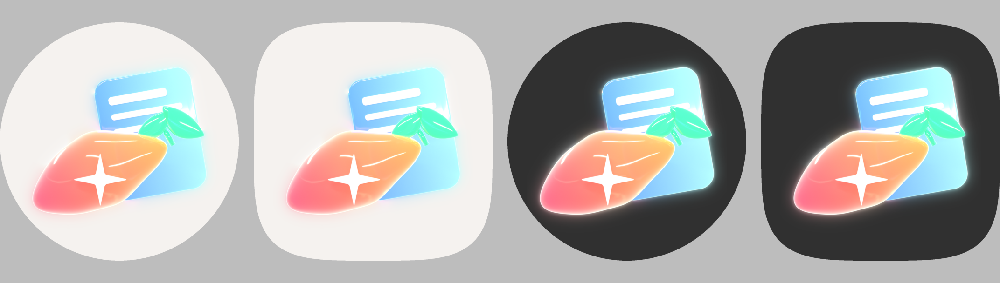

# ClearKit · 净界模块家族工具包

给“净界”系列 LSPosed 模块（哔哩净界、红薯净界……）用的**一整套做法**：怎么起名、怎么定颜色、怎么做图标、
设置界面怎么设计、模块代码怎么分层、从调研到发版每一步做什么、做到什么程度算过关。

目标是：**下一个模块照着这里做，人和 AI 都能直接上手**，做出来和家族里其它模块一个样子，又各有特色。
能力一般的模型（DeepSeek 等）也能接手：模板自带防漏检查，工作拆成任务卡，每一步有可照抄的代码和能跑的检查命令。


## 先看哪里

| 你要做的事 | 看这个 |
|---|---|
| 第一次了解这套东西 | [docs/00-overview.md](docs/00-overview.md)：家族是什么、哪些统一、哪些各自定 |
| 给新模块起名字 | [docs/01-naming.md](docs/01-naming.md) |
| 定强调色 | [docs/02-color.md](docs/02-color.md) |
| 设计图标（画什么、怎么构图） | [docs/03-icon-design.md](docs/03-icon-design.md) |
| 出图标（Blender 一条命令出全套资源） | [docs/04-icon-pipeline.md](docs/04-icon-pipeline.md) |
| 设计设置界面（实物预览） | [docs/05-live-preview-ui.md](docs/05-live-preview-ui.md) |
| **开一个新模块（一条命令生成能构建的项目）** | 下面“一条命令生成新模块”、[docs/06-module-architecture.md](docs/06-module-architecture.md) |
| 模块代码怎么分层 | [docs/06-module-architecture.md](docs/06-module-architecture.md) |
| 从零到发版的完整流程 | [docs/07-workflow.md](docs/07-workflow.md) |
| **让 AI 来做（逐步指令、提示词、自检）** | [docs/08-ai-playbook.md](docs/08-ai-playbook.md) 和 [AGENTS.md](AGENTS.md) |
| 装开发环境（从空电脑开始） | [docs/10-environment.md](docs/10-environment.md) |
| 加设置、写规则、写查询、挂方法……的逐步做法 | [docs/11-cookbook.md](docs/11-cookbook.md) |
| 让能力一般的模型接手（任务卡、护栏、交接） | [docs/09-low-capability-models.md](docs/09-low-capability-models.md) |
| 检查清单 | [docs/checklists/](docs/checklists/) |

## 一条命令生成新模块

```bash
python3 tools/new_module.py --out ~/projects/foo-clear --name 某某净界 --host 某某 \
  --host-package com.foo.app --package io.github.wzgrx.fooclear --code FooClear --repo wzgrx/FooClear
cd ~/projects/foo-clear && git init && git add -A && git commit -m "从 ClearKit 模板生成"
scripts/verify.sh        # 单测 + lint + release 包，第一次就应该通过
```

生成的项目带：两个示例功能（改接口 JSON 去广告、按特征找到方法挂钩子）、模块 App（功能页按设置自动生成、实物预览、
本机适配、诊断、备份）、宿主里的设置窗、门禁和冒烟脚本、给 AI 的 `AGENTS.md` 和交接文件 `docs/STATUS.md`、`docs/TASKS.md`。
需要 DexAdapt 和项目并排放（`~/projects/dexadapt`，见 [docs/10](docs/10-environment.md) 第 4 节）。

## 三分钟出一个图标

需要 Blender 4.2 以上（推荐 5.2），不用装别的。

```bash
# 1. 复制模板，改名字、颜色、形状（字段说明见 docs/04-icon-pipeline.md）
cp blender/specs/template.json blender/specs/mymodule.json

# 2. 快速看效果（512 像素、64 采样，几秒到十几秒）
blender -b --python blender/build_icon.py -- blender/specs/mymodule.json --out out/mymodule --quick

# 3. 满意了出正式图（1024 像素、512 采样）
blender -b --python blender/build_icon.py -- blender/specs/mymodule.json --out out/mymodule
```

`out/mymodule/` 里会有：母版 `master.png`、桌面效果 `preview.png`（浅色 / 深色 × 圆形 / 圆角方）、
可以直接复制进 Android 项目的 `android/res/`、应用商店用的 `store/icon-512.png`、宿主进程里用的 `host/brand_mark_192.png`，
以及检查结果 `report.txt`（内容有没有超出圆形遮罩）。

主题图标（Android 13+ 的单色图标）和快速设置磁贴用线稿：

```bash
python3 tools/svg2vector.py 线稿.svg -o app/src/main/res/drawable/ic_launcher_monochrome.xml
```



## 仓库里有什么

```
docs/                 规范和流程（按编号读）
  checklists/         每个阶段的检查清单
blender/
  crystal_kit.py      水晶玻璃图标的材质、灯光、形状、外发光、导出（一般不用改）
  build_icon.py       命令行入口：读 JSON 出全套图
  specs/              图标配置：shuclear.json（红薯净界定稿）、guo_trial.json（红果试做）、svg_demo.json（SVG 形状）、template.json（起步模板）
  specs/svg/          示例 SVG（小电视轮廓、红薯净界主题图标线稿）
  scenes/             定稿时的 Blender 场景（只作参考）
tools/svg2vector.py   SVG → Android 矢量图（主题图标、磁贴、通知小图标）
tools/new_module.py   从 starter/ 生成新模块项目
starter/              新模块模板（从哔哩净界抽出的通用骨架，能直接构建；改它要按 AGENTS.md 的规则验证）
templates/            新模块的文档模板（AGENTS.md、品牌说明、更新日志）
skills/               给 Claude Code 之类 AI 用的技能文件（实物预览设计、出图标）
examples/             家族图标、示例渲染
```

## 现有模块

| 模块 | 宿主 | 仓库 | 强调色 | 图标意象 |
|---|---|---|---|---|
| 哔哩净界 BiliClear | 哔哩哔哩 | wzgrx/BiliClear | 青绿 `#0B6E69` | 小电视 + 进度条播放键 |
| 红薯净界 ShuClear | 小红书 | wzgrx/ShuClear | 玫红 `#D6336C` | 红薯 + 笔记卡 + 四角星 |
| 红果映境 | （独立 App，非模块） | wzgrx/hongguo-jing | 红橙 | 琉璃胶片 + 播放键 |

红果映境不是 Xposed 模块，图标风格同源，名字不套“净界”。
